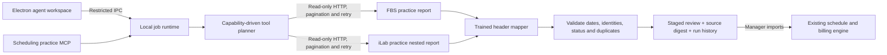

# Parity scheduling agent — 0.7.0

Working prototype for two **independent practice systems**, inspired by FBS and iLab export workflows. No vendor credentials, live university access, bookings or charges are changed.

In the desktop app, open **Scheduling agent**, choose FBS or iLab, a month and a scenario, then **Run scheduling agent**. Open the practice scheduler to see the source report in Chrome. Review the activity log and reservations, then **Use in Parity**. This temporarily replaces the current workspace's schedule and usage logs; reload restores saved billing rules. The synthetic data stays clearly marked. No automatic billing approval occurs.

## What actually runs



- **Agent runtime:** bounded autonomous read/observe/retry loop, capability discovery, source-specific report extraction, up to 10 pages, three attempts for temporary 429/502/503 responses, five-second request deadline, 1 MB response limit, cancellation and source count completeness check. Arbitrary URLs and redirects are disallowed. This is a constrained tool planner, not an LLM making unrestricted computer actions.
- **Connectors:** two different localhost report schemas and paginated HTTP endpoints. FBS simulator returns report tables; iLab simulator nests reports. Their paths are our own simulation contracts, **not documented vendor scheduling APIs**.
- **Local model:** multinomial Naive Bayes classifier trained on 80 labeled synthetic column names covering 10 field classes. `npm run agent:train` reproduces `model/columns.json` and `model/evaluation.json`. It scored 20/20 on held-out phrases using familiar vocabulary. This small benchmark does not establish performance on unseen institutions, real exports or schema drift. Model scores are not calibrated probabilities. Missing or ambiguous required columns stop the run.
- **Validation:** finite wall-clock dates, end after start, month bounds, known instrument, supported reservation status, duplicate identity/content checks. Invalid rows block import; they are never silently billed. Original source pages are hashed with SHA-256 for provenance.
- **Persistence:** atomic per-run JSON snapshots under Electron's user-data `agent-runs` directory, private file permissions, last 30 runs retained. In-progress runs appear interrupted after restart. No cloud database, paid API or GPU required.
- **Security boundary:** sandboxed renderer calls only fixed IPC operations; all source requests originate from the main backend. Dummy servers bind to 127.0.0.1, expose read-only synthetic fixtures and have no customer-data input. Existing iLab credentials remain in the separate credential flow.

## Run and verify

```sh
npm run agent:train
npm run agent:test
node tests/agent-mcp.test.cjs
npm run desktop:test
npm run desktop:start
```

`npm run agent:practice` starts the two viewable scheduling simulators without Electron and prints their URLs. Ctrl+C stops them.

The fixture has 24 unique reservations, one cancellation and one duplicate row across four pages. The retry scenario returns HTTP 429 once on page two. The invalid scenario adds a booking whose end precedes its start. John books 9–11; the synthetic computer log ends at 13:00. **The agent does not infer experiment end time from that login.**

## External MCP agent

The Connections screen now gives settings for the existing five-tool billing MCP plus the separate two-tool scheduling-practice MCP. The new process exposes:

- `parity_pull_practice_schedule(system, month, scenario?)`: starts the bounded workflow.
- `parity_practice_run_status(run_id)`: returns progress and final synthetic records.

The scheduling MCP owns an in-memory runtime separate from the desktop workspace. It does not silently import into the app. Both Node and the packaged Electron binary (`ELECTRON_RUN_AS_NODE=1`) can run `agent/mcp.cjs`. No client permissions are changed automatically.

## What can be pitched accurately

“Parity has a local scheduling agent that collects paginated records from two realistic practice systems, maps their columns with a small trained model, and stages validated bookings for a manager's review. It also exposes that workflow over MCP.”

Live FBS and iLab scheduling access, enterprise authentication/SSO, production browser automation, model generalization, real customer time savings and upstream billing writes remain **unvalidated**. Existing export-folder ingestion and iLab equipment-token connection continue to work.

Vendor references reviewed November 14, 2026: [Priority FBS](https://www.prioritysoftware.com/fbs-core-facility-management-software/), [Agilent iLab API access](https://help.ilab.agilent.com/ilab-api). Simulators reproduce workflow concepts, not proprietary vendor software or an authenticated API contract.
