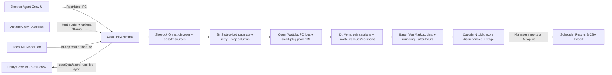

# Parity multi-agent crew — 1.1.0

Selectable 6-agent crew, 7 locally trained supervised ML models, optional local Ollama LLM briefing/routing, and live-synced MCP tools for core facility scheduling, smart-plug telemetry, matching, pricing, and discrepancy auditing. Runs locally on your computer against FBS/iLab practice simulators or your loaded Parity workspace spreadsheets. No vendor credentials, cloud APIs, or automatic upstream charges.

## The 6 specialist agents

1. **Sherlock Ohms** (`scout`) · *Source Scout* — `source_classifier` (hybrid NB + Softmax text model). Discovers endpoints/catalogs, classifies uploaded files (`reservations`, `usage_log`, `power_telemetry`, `price_sheet`, `unrelated_notes`), and hashes source payloads with SHA-256.
2. **Sir Slots-a-Lot** (`scheduler`) · *Schedule Puller* — `column_mapper` (hybrid NB + Softmax text model). Paginates FBS/iLab booking reports with bounded 429/502/503 retries, maps unfamiliar column headers, deduplicates pages, and blocks invalid rows.
3. **Count Wattula** (`telemetry`) · *Plug & Log Collector* — `power_state` (hybrid Softmax + Gaussian NB tabular model). Collects workstation logon/logoff sessions and smart-plug watt streams, separating `active_acquisition` laser/pump runs from `standby_idle` file copying, `off`, and `sensor_dropout`.
4. **Dr. Venn** (`matcher`) · *Session Matcher* — `session_matcher` (hybrid Softmax + Gaussian NB tabular model). Pairs reservations with PC & active plug runs across operators and days, isolating unbooked walk-ups and no-shows without guessing missing logouts.
5. **Baron Von Markup** (`pricer`) · *Rate & Rule Pricer* — `policy_pricer` (hybrid NB + Softmax text model). Classifies rate-card modes, user tiers, and billing clauses; applies rounding increments and after-hours/weekend splits.
6. **Captain Nitpick** (`auditor`) · *Discrepancy Auditor* — `anomaly_auditor` (hybrid Softmax + Gaussian NB tabular model). Audits every reconciled session (`clean_match`, `overrun`, `idle_login_mismatch`, `walk_up_unbooked`, `no_show`, `short_underrun`, `duration_outlier`) and stages flags for manager sign-off.
7. **Crew Commander** (`agent/commander.cjs`) — `intent_router` (7th trained model). Routes natural-language goals in **Ask the crew** and `parity_ask_crew`, optionally augmented by a local Ollama model (`127.0.0.1:11434`, e.g. `llama3.2:1b`, `phi3:latest`).

## What actually runs



- **Selectable & solo runs:** Enable/disable any subset of agents, pick a preset (`Full Crew (All 6)`, `Schedule Pull Only`, `Sensors & Match`, `Booked-Time Billing`), or click **Solo run** on a single agent.
- **Built-in ML vs Local Ollama LLM:** Switch between **Built-in Trained ML** (instant offline across all 7 models) and **Built-in ML + Local Ollama LLM** (`llama3.2:1b` / `phi3:latest` on `127.0.0.1:11434` for goal planning and plain-English executive briefings while keeping all billing math deterministic).
- **Ask the Crew & Autopilot:** Type a natural-language task or pick a quick mission; with **Auto-apply clean runs into Parity** enabled, the crew runs end-to-end and opens Schedule or Results automatically (stopping before billing export for human approval).
- **In-app local training:** Click **Train all 7 models** or **Fine-tune on my sessions** right inside the app (`runtime.train()`). Because packaged Electron bundles (`app.asar`) are read-only, in-app training writes atomic weights to `trained-models.json` inside Electron's `userData/agent-runs` directory and hot-reloads immediately.
- **CLI training & evaluation:** `npm run agent:train` trains all 7 models deterministically on 1,540 synthetic training examples and evaluates on 362 non-overlapping held-out examples, writing `agent/model/columns.json`, `agent/model/models.json`, and `agent/model/evaluation.json`.
- **Pitch story scenario:** Includes the full `pitch` practice scenario alongside `normal`, `retry`, and `invalid`: John's overrun + idle file-copy tail (`09:02–12:30` active laser + `12:30–13:00` standby file copy), Adam's unbooked walk-up (`14:15–15:45`), John's next-day no-show, and Billy's 20-minute sprint on a 3-hour booking.
- **Security boundary:** Sandboxed renderer calls only fixed IPC handlers (`parity:agent:info|start|ask|llm|get|cancel|train|practice`). Dummy simulators bind only to `127.0.0.1` and expose read-only synthetic fixtures.

## Run and verify

```sh
npm run agent:train
node tests/crew-models.test.cjs
node tests/mcp-crew.test.cjs
npm run agent:test
node tests/agent-mcp.test.cjs
npm run desktop:test
npm run desktop:start
```

## External MCP agent

`agent/mcp.cjs` runs in two modes:
- Default (no flags): two-tool scheduling practice server (`parity_pull_practice_schedule`, `parity_practice_run_status`).
- Full-crew mode (`--full-crew --runs-dir <dir> [--folder <dir>] [--rules <file>]`, wired on the **Connections** screen): exposes 6 tools (`parity_list_agents`, `parity_run_agent`, `parity_ask_crew`, `parity_train_models`, `parity_pull_practice_schedule`, `parity_practice_run_status`) so Claude Desktop or Codex can summon any funny-named agent individually or in presets and watch results sync live into the open Parity app.

## Limits

Live FBS and iLab scheduling APIs, enterprise SSO, real customer exports, unseen-institution model generalization, and upstream billing pushes remain unvalidated in the practice simulator. Workspace mode runs the crew directly on local CSV/Excel files you provide in Parity.
